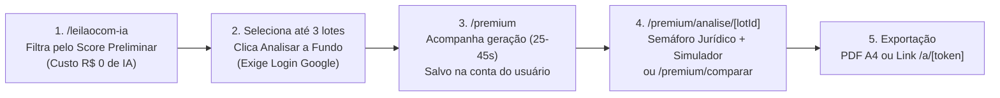

# Plano 1 — Produto: finHouse Premium (Login Google · 15 Dias Grátis · 3 Lotes/Dia)

> **Estratégia**: validar demanda com usuários reais (identificados via **Login Google**) antes de ligar o gateway de pagamento.
> - **Agora (MVP)**: **Login com Google** → **15 dias grátis** → **até 3 análises profundas novas por dia** + páginas dedicadas (`/leilaocom-ia/premium`, `/leilaocom-ia/premium/analise/[lotId]`, `/leilaocom-ia/premium/comparar`, `/a/[token]`). Implementação técnica no **[Plano 2 — MVP](./paywall-plano-2-mvp-login-acesso.md)**.
> - **Depois (validada a demanda)**: cobrança de **R\$ 59,90 por 6 meses** (`R$ 9,98/mês`) via Asaas — **[Plano 3 — Fase 2](./paywall-plano-3-asaas-fase2.md)**.

---

## 1. Benchmark Internacional & Brasileiro (Best Practices aplicadas nas novas páginas)

Estudamos as referências dos EUA (**DealCheck**, **PropertyRadar**, **PropertyOnion**, **PropStream**) e do Brasil (**Pro Leilão**, **Smart Leilões**, **LancePro**):

| Plataforma | O que eles fazem de melhor | Como entra nas páginas da finHouse |
|---|---|---|
| **PropertyOnion** *(EUA — leilões judiciais/fiscais)* | **Semáforo de Risco Documental (`🟢 OK · 🟡 Atenção · 🔴 Crítico`)** no topo do relatório em vez de textos jurídicos longos | Na página `/premium/analise/[lotId]`, os 8 itens da Matriz Jurídica têm semáforo visual + citação literal e página do Edital/Matrícula |
| **PropertyRadar** *(EUA — foreclosures)* | **Triagem *Bid / No-Bid* já na lista** antes de gastar tempo/créditos em documentos pesados | Em `/leilaocom-ia` e `/premium`, todos os lotes mostram **Score Preliminar (0–100)** + selos de alerta calculados sem IA (custo zero) |
| **DealCheck** *(EUA — análise de imóveis)* | **Calculadora Reversa de Lance Teto (*Max Offer*)** com sliders em tempo real + **Link Público Compartilhável (`/a/[token]`)** + PDF 1-clique | Em `/premium/analise/[lotId]`, o investidor ajusta lance, reforma e prazo e vê na hora o **Lance Teto Recomendado**; pode baixar PDF ou enviar link `/a/[token]` no WhatsApp |
| **Pro Leilão / Smart Leilões** *(BR)* | **Sistema de créditos + Cache compartilhado** (lote já analisado abre na hora e custa **0 créditos**) | Limite de **3 análises novas/dia** por conta Google; lotes já analisados têm selo `⚡ Análise Pronta (0 crédito)` e abrem instantaneamente |

---

## 2. A Oferta do MVP e Regras de Controle

| Item | Definição |
|---|---|
| **Entrada obrigatória** | **Login com Google** (garante 1 conta = 1 e-mail verificado, histórico salvo e controle real no servidor) |
| **Período de Teste** | **15 dias grátis** a partir do 1º login com Google, sem pedir cartão |
| **Cota Diária de IA** | **Até 3 análises profundas novas por dia** (zera à 00:00 BRT) |
| **Relatórios já existentes (Cache)** | **Ilimitados e instantâneos (< 1s)** — não descontam das 3 análises do dia |
| **Preço Pós-Teste (6 meses)** | **R\$ 59,90 pagamento único** (= **R\$ 9,98/mês**, abaixo da barreira psicológica de R\$ 10/mês) |
| **Fim dos 15 dias** | Bloqueia novas análises e exibe na página `/premium`: *"Desbloqueie 6 meses completos por R\$ 59,90 (R\$ 9,98/mês)"* → registra o clique/WhatsApp como métrica real de conversão |

---

## 3. Mapa das Páginas (Visitante vs. Logado no Teste de 15 Dias)

| Página / Recurso | Visitante (sem login) | Logado com Google (15 dias) |
|---|---|---|
| **`/leilaocom-ia`** (Mapa, lista, filtros básicos e resumo rápido) | ✅ | ✅ |
| **Score Preliminar (0–100) + Selos na lista** (sem IA) | Score visível | ✅ Completo + ordenar por maior score + selo `⚡ Análise Pronta` |
| **`/premium`** (Painel do Investidor: carteira de análises, status dos 15 dias, cota `3/3`, favoritos e exportar CSV) | 🔒 Pede Login Google | ✅ |
| **`/premium/analise/[lotId]`** (Dossiê Profundo + Semáforo Jurídico + Calculadora Reversa de Lance Teto + PDF) | 🔒 Prévia borrada | ✅ **3 novos/dia** + ilimitados do cache |
| **`/premium/comparar`** (Comparativo lado a lado de 2 a 3 lotes + PDF Paisagem) | ❌ | ✅ |
| **`/a/[token]`** (Link compartilhável somente leitura para sócio/advogado) | ✅ Pode **abrir** link recebido (com CTA *"Teste 15 dias grátis"*) | ✅ Pode **gerar** e compartilhar links |

---

## 4. Fluxo Completo do Usuário e Travas de Custo de IA

### 4.1. Como garantimos que a IA não seja consumida à toa
1. **Login Google obrigatório antes de acionar o motor profundo**: visitantes anônimos nunca disparam leitura de PDFs na IA.
2. **Triagem prévia sem IA (`prelimScore`)**: o usuário já filtra os melhores imóveis pela nota preliminar e selos antes de escolher seus **3 lotes do dia**.
3. **Cache compartilhado no Supabase (`lot_reports`)**: cada lote é analisado pela IA **apenas 1 vez**. Se outro usuário já analisou aquele imóvel, ele abre em `< 1s` e consome **0 da cota diária**.
4. **Simulador financeiro 100% no código (`financials.ts`)**: a IA só lê e extrai dados dos PDFs; todos os cálculos de ITBI, reforma, IR, ROI e Lance Teto rodam no navegador sem gastar tokens.
5. **Trava atômica no banco + Teto global diário**: `reserve_credit` no Postgres impede mais de 3 análises novas/dia por usuário, e um teto global (ex.: 150 análises novas/dia no site todo) protege o orçamento.

---

## 5. O que tem em cada uma das Novas Páginas

### 5.1. Painel `/premium` (Minhas Análises & Carteira)
- **Header do Assinante**: *"Período de Teste: **12 dias restantes** · Análises de hoje: **2 de 3 disponíveis**"* + botão de upgrade (`R$ 59,90 / 6 meses`).
- **Aba "Minhas Análises"**: cards dos lotes analisados pelo usuário com status (*Lendo Edital e Matrícula… → Pronto*), Score finHouse, Lance Mínimo vs. **Lance Teto**, quantidade de alertas `🔴/🟡` e checkboxes para **"Comparar Lado a Lado (até 3)"**.
- **Aba "Catálogo & Favoritos"**: tabela filtrável de alta densidade (estilo *PropertyRadar*) com botão **Exportar CSV**.

### 5.2. Página do Dossiê `/premium/analise/[lotId]`
1. **Capa & Veredito (`🟢 Recomendado até o Lance Teto` · `🟡 Exige Reserva` · `🔴 Alto Risco`)**:
   - Identificação completa, Score finHouse (0–100) e barra visual *1ª Praça × 2ª Praça × Avaliação × Valor de Mercado Estimado*.
2. **Matriz Jurídica com Semáforo (8 itens extraídos dos PDFs)**:
   - Cada item traz `🟢 OK`, `🟡 Atenção` ou `🔴 Crítico` + **trecho literal e página do Edital/Matrícula**:
     1. Natureza e Rito (Extrajudicial Lei 9.514/97 vs. Judicial)
     2. Dívidas de IPTU (Sub-rogação art. 130 CTN vs. arrematante)
     3. Dívidas de Condomínio (*Propter rem* / regras do edital)
     4. Situação Ocupacional & Prazo/Custo de Desocupação
     5. Formas de Pagamento (À vista, Parcelamento CPC art. 895, Financiamento)
     6. Gravames e Ônus na Matrícula (Penhoras, indisponibilidade, usufruto)
     7. Comissão do Leiloeiro (5%) e Taxas Extras
     8. Links oficiais clicáveis (Edital, Matrícula, Laudo)
3. **Calculadora Reversa de Lance Teto (Simulador Interativo)**:
   - Sliders de **Lance Simulado**, **Nível de Reforma SP** (*Sem reforma · Cosmética · Intermediária · Pesada*) e **Estratégia** (*Revenda em 6/9/12m vs. Locação*).
   - Destaca o **Lance Teto finHouse** (maior lance que preserva ≥ 18% de margem líquida), DRE completa com todos os custos (5% leiloeiro, 3% ITBI, cartório, vacância, 6% corretagem, 15% IR) e ROI líquido.
4. **Ações**: **Baixar PDF A4** (`window.print()` com layout dedicado) e **Compartilhar Link Público (`/a/[token]`)**.

### 5.3. Página Comparativa `/premium/comparar?lotes=a,b,c`
- Coloca **2 ou 3 lotes lado a lado** em uma única tela (e 1 página A4 paisagem ao clicar em **Baixar PDF**), destacando em verde o melhor **Lance Teto**, **Maior ROI**, **Menor Desembolso Total** e **Menor Risco Jurídico**.

---

## 6. Tempo e Custo com `3 lotes/dia · 15 dias`

| Métrica | Valor (Gemini 2.5 Flash lendo PDFs) |
|---|---|
| **Tempo de 1 análise inédita** | **25 a 45 segundos** (até 3 em paralelo: ~1 min) |
| **Tempo de lote já em cache** | **< 1 segundo** |
| **Custo por lote inédito** (~40 págs. PDF) | **~US\$ 0,025 (≈ R\$ 0,15)** |
| **Custo máximo por usuário/dia** (3 lotes inéditos) | **~R\$ 0,45 / dia** |
| **Pior caso de 1 usuário nos 15 dias** (45 lotes 100% inéditos, zero cache) | **~R\$ 6,75** (antes, com 5/dia × 30d, era R\$ 22) |
| **Custo médio real por usuário no teste** (com cache compartilhado) | **R\$ 1,00 a R\$ 2,50** |
| **Margem no plano de R\$ 59,90 (6 meses)** | **> 85% de margem líquida** |

---

## 7. Métricas de Demanda (Para acionar a Fase 2 com Asaas)

| Indicador medido no Supabase | Meta de validação |
|---|---|
| Visitantes → Login Google | Taxa de conversão de cadastro |
| Usuários logados que geram ≥ 1 análise profunda | **> 50%** |
| Retorno em múltiplos dias durante os 15 dias | **> 25%** |
| Links `/a/[token]` compartilhados com sócios/advogados | Coeficiente viral |
| **Cliques em "Assinar 6 meses por R\$ 59,90"** (ao bater limite ou expirar os 15 dias) | **> 10%** dos usuários ativos |

---

## Anexo A — Tabela de Reforma SP (R\$/m² — Base do Simulador)

| Nível | Econômico | Médio | Alto Padrão |
|---|---|---|---|
| **0 — Sem reforma / Só limpeza** | R\$ 0 | R\$ 0 | R\$ 0 |
| **1 — Cosmética** (pintura, revisão pontual) | R\$ 550/m² | R\$ 800/m² | R\$ 1.300/m² |
| **2 — Intermediária** (pisos, bancadas, banheiros) | R\$ 1.250/m² | R\$ 1.850/m² | R\$ 3.000/m² |
| **3 — Pesada / Retrofit** (elétrica, hidráulica, layout) | R\$ 2.800/m² | R\$ 3.200/m² | R\$ 4.500/m² |

*Acréscimo automático de **+15% para Casas** (telhado, fachada e área externa).*
