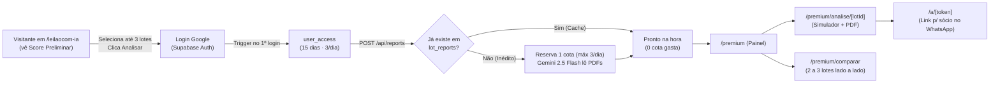

# Plano 2 — Implementação Técnica do MVP: Login Google + Acesso (15 Dias · 3 Lotes/Dia) + Novas Páginas

> **Escopo deste plano**:
> 1. **Login com Google** (Supabase Auth) para controle rigoroso por usuário.
> 2. **Controle de acesso no servidor**: **15 dias de teste grátis** + cota de **3 análises profundas inéditas por dia** (lotes já em cache abrem na hora e custam 0 crédito).
> 3. **Novas páginas dedicadas**: `/leilaocom-ia/premium` (Painel & Carteira), `/leilaocom-ia/premium/analise/[lotId]` (Dossiê com Semáforo Jurídico `🟢🟡🔴` + Calculadora Reversa de Lance Teto + PDF), `/leilaocom-ia/premium/comparar` (Comparativo de até 3 lotes) e `/a/[token]` (Link público compartilhável).
> 4. **Captura de demanda pós-teste**: oferta de **R\$ 59,90 por 6 meses** (`R$ 9,98/mês`) preparando a virada para o **[Plano 3 — Asaas](./paywall-plano-3-asaas-fase2.md)**.

---

## 1. Fluxo da Arquitetura



---

## 2. Login com Google (Supabase Auth)

### 2.1. Configuração (Google Cloud + Supabase — ~45 min)
1. **Google Cloud Console** → *APIs e Serviços > Credenciais > Criar ID do cliente OAuth (Aplicativo da Web)*:
   - Redirect URI autorizado: `https://ovwlviiojtktuhmvqahi.supabase.co/auth/v1/callback`
   - Tela de consentimento: escopos `openid email profile`, nome **"finHouse"**, logo e links `/lgpd` e `/termos-e-condicoes`, status **"Em produção"**.
2. **Supabase** → *Authentication > Providers > Google*: ativar e colar Client ID e Secret.
3. **Supabase** → *Authentication > URL Configuration*:
   - Site URL: `https://www.finhouse.com.br`
   - Redirect URLs: `https://www.finhouse.com.br/**`, `http://localhost:3000/**` e URLs de preview da Vercel.

### 2.2. Código de Autenticação
- **`src/contexts/AuthContext.tsx`**:
  - Adicionar `loginWithGoogle(returnTo?: string)` usando `supabase.auth.signInWithOAuth({ provider: "google", options: { redirectTo } })`.
  - Adicionar estado `access`: `{ plan, expiresAt, daysLeft, isActive, usedToday, creditsLeftToday }` carregado de `GET /api/me/access`.
  - Antes do redirect para o Google, salvar em `sessionStorage` os lotes selecionados (`fh_pending_lots`) para restaurar automaticamente quando voltar.
  - Manter `/login` (e-mail/senha) exclusivo para admin (`isAdmin`), que tem acesso ilimitado.
- **`src/lib/supabase-admin.ts` & `src/lib/auth-server.ts`**:
  - Cliente servidor com `SUPABASE_SERVICE_ROLE_KEY`.
  - `getUser(req)` valida `Authorization: Bearer <access_token>`.
  - `requireActiveAccess(req)` retorna `401` se não logado ou `403` (`TRIAL_EXPIRED`) se os 15 dias venceram.

---

## 3. Banco de Dados no Supabase (SQL Completo)

```sql
-- 1. Acesso do usuário (15 dias de teste + 3 análises novas/dia)
create table user_access (
  user_id uuid primary key references auth.users on delete cascade,
  email text,
  plan text not null default 'trial',        -- trial | premium | admin
  started_at timestamptz not null default now(),
  expires_at timestamptz not null default now() + interval '15 days',
  daily_limit int not null default 3,
  referred_by_token text
);

-- Cria o trial de 15 dias automaticamente no 1º login com Google
create or replace function handle_new_user() returns trigger as $$
begin
  insert into user_access (user_id, email)
  values (new.id, new.email)
  on conflict do nothing;
  return new;
end $$ language plpgsql security definer;

create trigger on_auth_user_created
  after insert on auth.users
  for each row execute function handle_new_user();

-- 2. Cache Global de Dossiês por Lote (compartilhado entre todos os usuários)
create table lot_reports (
  lot_id text primary key,
  source_url text not null,
  lot_hash text not null,          -- minBid + auctionDate (se mudar praça/valor, regera)
  status text not null,            -- processing | ready | failed
  payload jsonb,                   -- veredito + 8 itens jurídicos c/ semáforo + métricas extraídas
  ai_model text,
  error text,
  tokens_in int,
  tokens_out int,
  started_at timestamptz default now(),
  finished_at timestamptz
);

-- 3. Carteira de Análises do Usuário + Controle de Cota Diária (3/dia)
create table report_requests (
  id bigserial primary key,
  user_id uuid not null references auth.users on delete cascade,
  lot_id text not null,
  used_credit boolean not null,    -- false se veio do cache ou se falhou (cota devolvida)
  created_at timestamptz default now(),
  unique (user_id, lot_id)
);

-- 4. Favoritos sincronizados na conta Google
create table user_favorites (
  user_id uuid references auth.users on delete cascade,
  lot_id text not null,
  created_at timestamptz default now(),
  primary key (user_id, lot_id)
);

-- 5. Links Públicos Compartilháveis (/a/[token])
create table report_shares (
  token text primary key,          -- token curto/aleatório (ex: 16 chars)
  lot_id text not null,
  created_by uuid not null references auth.users on delete cascade,
  views int default 0,
  revoked boolean default false,
  created_at timestamptz default now()
);

-- 6. Interesse no Plano de R$ 59,90 / 6 meses (termômetro de demanda)
create table upgrade_interest (
  user_id uuid primary key references auth.users on delete cascade,
  email text,
  whatsapp text,
  reason text,                     -- 'daily_limit_3' | 'trial_15d_expired' | 'voluntary_cta'
  created_at timestamptz default now()
);
```

### Função Atômica `reserve_credit` (Trava de 3/dia e 15 dias)
```sql
create or replace function reserve_credit(p_user uuid, p_lot text) returns text as $$
declare
  acc user_access;
  used int;
begin
  select * into acc from user_access where user_id = p_user for update;
  if acc is null or (acc.plan <> 'admin' and acc.expires_at < now()) then
    return 'expired';
  end if;

  select count(*) into used from report_requests
   where user_id = p_user
     and used_credit = true
     and created_at >= date_trunc('day', now() at time zone 'America/Sao_Paulo') at time zone 'America/Sao_Paulo';

  if acc.plan <> 'admin' and used >= acc.daily_limit then
    return 'limit';
  end if;

  insert into report_requests (user_id, lot_id, used_credit)
  values (p_user, p_lot, true)
  on conflict (user_id, lot_id)
  do update set used_credit = true, created_at = now();

  return 'ok';
end $$ language plpgsql security definer;
```

---

## 4. Rotas de API e Motor do Dossiê

| Rota | Acesso | O que faz |
|---|---|---|
| `GET /api/me/access` | Logado | Retorna `{ plan, expiresAt, daysLeft, isActive, usedToday, creditsLeftToday }` |
| `POST /api/reports` | Ativo | Recebe `{ lotIds: string[] }` (máx. 3). Se o lote já estiver pronto em `lot_reports`, vincula com `used_credit=false` (0 cota). Se for inédito, chama `reserve_credit` e dispara a leitura dos PDFs com `after()` |
| `GET /api/reports` | Logado | Lista todas as análises do usuário + status (`processing | ready | failed`) para `/premium` |
| `GET /api/reports/[lotId]` | Ativo + dono | Retorna o JSON completo do dossiê para `/premium/analise/[lotId]` e `/premium/comparar` |
| `POST /api/reports/[lotId]/share` | Ativo + dono | Gera/retorna o link público `/a/[token]` |
| `POST /api/me/upgrade-interest` | Logado | Registra o interesse em assinar por **R\$ 59,90 / 6 meses** |

### Módulos em `src/lib/leiloes/`
1. **`prelim-score.ts` (Triagem sem IA)**:
   - Calcula `prelimScore` (0–100) e `badges` (`⚡ Análise Pronta`, `🏦 Financia`, `⚠️ Ocupado`) direto em `/api/leiloes`.
2. **`deep-report.ts` (Motor Gemini 2.5 Flash lendo PDFs)**:
   - Baixa os PDFs anexados ao lote (Edital, Matrícula, Laudo) e envia ao Gemini 2.5 Flash com JSON Schema estrito:
     - `verdict`: `{ status: "green" | "yellow" | "red", headline, summary }`
     - `legalMatrix`: 8 itens com `{ id, title, level: "green" | "yellow" | "red", finding, citation, documentName, page }`
     - `extractedMetrics`: `{ areaM2, condominiumFeeEst, iptuMonthlyEst, standardTier, suggestedReformaLevel }`
3. **`financials.ts` (Isomórfico — Servidor & Navegador)**:
   - Calcula **Lance Teto Recomendado** (margem líquida mínima de 18%), custos de entrada (5% leiloeiro + 3% ITBI + registro), reforma SP (`Anexo A` do Plano 1), vacância, corretagem (6%), IR (15%), Lucro Líquido e ROI %.

---

## 5. Especificação das Páginas no Frontend

### 5.1. `/leilaocom-ia` (Vitrine + Seleção de até 3 Lotes)
- **Remover**: modal de chave PIX estática (`R$ 49,90`) e botão "Já realizei o PIX".
- **Cards e Mapa**: exibem **Score Preliminar (0–100)** + selo `⚡ Análise Pronta (0 crédito)` quando já houver cache em `lot_reports`.
- **Bandeja Flutuante de Seleção**: permite marcar até **3 lotes** (*"2 de 3 selecionados · 3 créditos restantes hoje"*) + botão **"Gerar Dossiês Completos"**:
  - Se não estiver logado → abre modal *"Teste Grátis por 15 Dias · Continuar com Google"*.
  - Se logado → envia `POST /api/reports` e leva para `/premium`.

### 5.2. `/premium` (Painel do Investidor)
- **Barra de Status**: dias restantes dos 15 dias + indicador visual das **3 análises do dia (`●●○`)** + botão **"Desbloquear 6 meses por R\$ 59,90"**.
- **Aba 1 — Minhas Análises**:
  - Lista os lotes solicitados pelo usuário (polling automático de 4s enquanto algum estiver em `processing`).
  - Mostra Score final, Lance Mínimo vs. **Lance Teto**, quantidade de alertas `🔴/🟡` e seleção (2 ou 3 lotes) para clicar em **"Comparar Lado a Lado"** (`/premium/comparar`).
- **Aba 2 — Catálogo Completo & Favoritos**:
  - Tabela densa com todos os filtros, favoritos sincronizados no Supabase (`user_favorites`) e botão **Exportar CSV**.

### 5.3. `/premium/analise/[lotId]` (Página do Dossiê + Simulador + PDF)
- **Bloco 1 — Capa & Veredito (`🟢 / 🟡 / 🔴`)** + comparativo *1ª Praça × 2ª Praça × Avaliação × Mercado Estimado*.
- **Bloco 2 — Matriz Jurídica com Semáforo (8 Itens)**: cartões com `🟢 OK`, `🟡 Atenção`, `🔴 Crítico` + trecho literal e página do Edital/Matrícula + links para baixar os PDFs originais.
- **Bloco 3 — Calculadora Reversa de Lance Teto**:
  - Sliders de **Lance Simulado**, **Nível de Reforma SP** e **Prazo/Estratégia** recalculando instantaneamente via `financials.ts` no navegador.
- **Barra de Ações**: **Baixar PDF A4** (`window.print()` com `@media print` dedicado) e **Compartilhar Link (`/a/[token]`)**.

### 5.4. `/premium/comparar?lotes=a,b,c` (Comparativo de 2 a 3 Lotes)
- Tabela comparativa lado a lado destacando em verde o melhor indicador de cada linha (**Maior Margem até o Lance Teto**, **Maior ROI**, **Menor Risco Jurídico**, **Menor Custo de Reforma/Vacância**).
- Botão **Baixar PDF Comparativo** (1 página A4 paisagem).

### 5.5. `/a/[token]` (Página Pública Compartilhável — Motor de Aquisição)
- Renderizada no servidor sem exigir login para quem recebe o link no WhatsApp.
- Mostra o dossiê em modo leitura + barra fixa: *"Análise gerada na finHouse · Teste grátis por 15 dias (3 dossiês/dia) entrando com Google"*.

---

## 6. Variáveis de Ambiente

```bash
SUPABASE_SERVICE_ROLE_KEY=        # novo (servidor apenas)
GEMINI_API_KEY=                   # chave paga do Gemini 2.5 Flash
TRIAL_DAYS=15
REPORTS_DAILY_PER_USER=3
REPORTS_GLOBAL_DAILY_CAP=150
```

---

## 7. Roteiro de Execução (~6,5 dias)

| # | Etapa | Entregável | Estimativa |
|---|---|---|---|
| 1 | Config Google OAuth + Supabase Auth + `AuthContext` + Header | Botão "Continuar com Google" funcionando em local e produção | 0,5 dia |
| 2 | SQL no Supabase (`user_access` 15d, `lot_reports`, `report_requests`, `reserve_credit`, RLS) | Novo login Google ganha 15 dias e limite de 3/dia | 0,5 dia |
| 3 | `supabase-admin.ts`, `auth-server.ts`, `GET /api/me/access` | Front exibe dias restantes e cota `3/3` | 0,5 dia |
| 4 | `prelim-score.ts`, `financials.ts` (isomórfico) e `deep-report.ts` (Gemini lendo PDFs) | Motor gerando JSON com semáforo jurídico e lance teto | 1,5 dia |
| 5 | Rotas `POST/GET /api/reports` e `GET /api/reports/[lotId]` | Cache global (0 crédito) + trava de 3 inéditos/dia | 1 dia |
| 6 | Atualizar `/leilaocom-ia` (score preliminar, seleção de até 3 lotes, remoção do PIX antigo) | Fluxo de triagem e seleção pronto | 0,5 dia |
| 7 | Novas páginas `/premium` e `/premium/analise/[lotId]` (Semáforo + Simulador + PDF) | Painel e página de dossiê completos | 1 dia |
| 8 | Páginas `/premium/comparar`, `/a/[token]` e modal de conversão (`R$ 59,90 / 6 meses`) | Comparativo, link viral e captura de demanda prontos | 1 dia |
