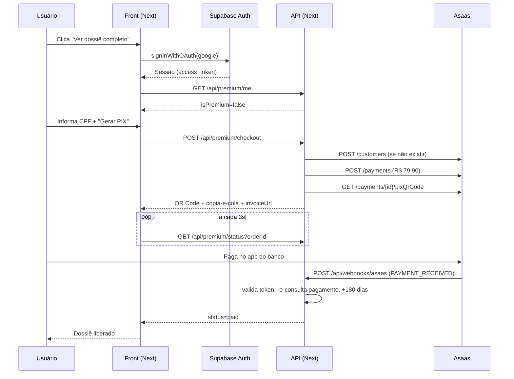

# Plano 3 — FASE 2 (futuro): Paywall Asaas (`R$ 59,90` / 6 meses)

> [!NOTE]
> **Só executar depois de validar demanda com o teste grátis de 15 dias (com Login Google)** ([Plano 2 — MVP](./paywall-plano-2-mvp-login-acesso.md)).
> Como o Login Google e a tabela `user_access` já estarão em produção pelo MVP, esta fase adiciona apenas a cobrança no Asaas: o webhook atualiza `plan='premium'` e soma `+ 180 dias` em `expires_at` por **R\$ 59,90** (`R$ 9,98/mês`), mantendo o limite de **3 análises inéditas/dia** (e cache ilimitado).

> **Escopo**: implementação do acesso Premium definido no **[Plano 1](./paywall-plano-1-produto-premium.md)** — login só com Google (Supabase Auth), cobrança única de **R$ 59,90** no **Asaas** (PIX + cartão) e liberação de **180 dias** de acesso, validada **no servidor**.
>
> Stack atual: Next.js 16 (App Router) · Supabase (`@supabase/supabase-js`) · Resend · Vercel. Nenhuma dependência nova é obrigatória.

---

## 0. Situação atual (o que muda)

| Hoje | Depois |
|---|---|
| `leilaocom-ia/page.tsx` mostra chave PIX estática; botão "Já realizei o PIX" libera via estado local (`unlockedLots`) | Cobrança Asaas real; liberação só após webhook confirmar |
| `/api/leiloes/analyze` é aberta (qualquer um consome IA) | Exige token de usuário Premium + cache + limite diário |
| Login e-mail/senha só para admin (`/login` → `/dashboard`) | **Mantém** para admin. Clientes usam **apenas Google** |
| Favoritos em `localStorage` | Tabela `user_favorites` no Supabase |

---

## 1. Fluxo completo



---

## 2. Parte A — Login com Google (Supabase Auth)

### 2.1. Configuração (sem código)
1. **Google Cloud Console** → APIs e Serviços → Credenciais → *Criar ID do cliente OAuth* (tipo **Aplicativo da Web**).
   - URI de redirecionamento autorizado: `https://ovwlviiojtktuhmvqahi.supabase.co/auth/v1/callback`
   - Tela de consentimento: escopos básicos (`email`, `profile`, `openid`) — não exigem verificação do Google. Publicar o app como **"Em produção"** (senão só usuários de teste conseguem logar). Nome do app "finHouse" + logo + links de `/lgpd` e `/termos-e-condicoes`.
2. **Supabase** → Authentication → Providers → **Google**: colar Client ID e Secret.
3. **Supabase** → Authentication → URL Configuration:
   - Site URL: `https://www.finhouse.com.br`
   - Redirect URLs: `https://www.finhouse.com.br/**`, `http://localhost:3000/**`, `https://*-finhouse.vercel.app/**` (previews)

### 2.2. Código
- **`src/contexts/AuthContext.tsx`** — adicionar:
  ```ts
  loginWithGoogle: (returnTo?: string) => Promise<void>
  // supabase.auth.signInWithOAuth({ provider: "google",
  //   options: { redirectTo: `${window.location.origin}${returnTo ?? window.location.pathname}` } })
  isPremium: boolean
  premiumExpiresAt: string | null
  refreshPremium: () => Promise<void>   // chama GET /api/premium/me
  ```
  O `supabase-js` já detecta a sessão na URL de retorno (`detectSessionInUrl`), então **não precisa de rota `/auth/callback`** no MVP.
- **Voltar ao lote certo após o login**: antes de redirecionar, salvar `sessionStorage.setItem("fh_pending_lot", lotId)`; ao montar a página, se houver sessão + `fh_pending_lot`, reabre o modal daquele lote.
- **Admin**: `isAdmin` continua por lista de e-mails; `/login` com senha permanece só para a equipe. Admin é tratado como Premium automaticamente.

### 2.3. Autenticação nas rotas de API
- O front envia `Authorization: Bearer <session.access_token>`.
- Novo **`src/lib/supabase-admin.ts`** (somente servidor) com `SUPABASE_SERVICE_ROLE_KEY`.
- Helper **`src/lib/auth-server.ts`**:
  ```ts
  getUserFromRequest(req) // supabaseAdmin.auth.getUser(token) → user | null
  requirePremium(req)     // user + premium_access.expires_at > now() (ou admin) → senão 401/402
  ```

---

## 3. Parte B — Banco de dados (Supabase)

```sql
-- Cliente Asaas vinculado ao usuário Google
create table customers (
  user_id uuid primary key references auth.users on delete cascade,
  asaas_customer_id text unique not null,
  name text, cpf_cnpj text not null,
  created_at timestamptz default now()
);

-- Pedidos (1 linha por cobrança)
create table orders (
  id uuid primary key default gen_random_uuid(),
  user_id uuid not null references auth.users,
  asaas_payment_id text unique not null,
  amount_cents int not null default 5990,
  access_days int not null default 180,
  status text not null default 'pending', -- pending | paid | refunded | expired | canceled
  billing_type text,                       -- PIX | CREDIT_CARD (preenchido no webhook)
  invoice_url text, pix_payload text, pix_expires_at timestamptz,
  created_at timestamptz default now(), paid_at timestamptz
);

-- Direito de acesso (1 linha por usuário; fonte da verdade do paywall)
create table premium_access (
  user_id uuid primary key references auth.users on delete cascade,
  expires_at timestamptz not null,
  updated_at timestamptz default now()
);

-- Idempotência do webhook
create table asaas_webhook_events (
  event_id text primary key,
  event text, asaas_payment_id text, payload jsonb,
  received_at timestamptz default now()
);

-- Cache de dossiês (compartilhado entre usuários)
create table lot_dossiers (
  lot_id text primary key,
  lot_hash text not null,        -- hash de lance mínimo + datas das praças → invalida se mudar
  payload jsonb not null, ai_model text,
  generated_at timestamptz default now()
);

-- Limite de gerações novas por usuário/dia
create table dossier_generations (
  id bigserial primary key, user_id uuid not null, lot_id text not null,
  created_at timestamptz default now()
);

create table user_favorites (
  user_id uuid references auth.users on delete cascade, lot_id text,
  created_at timestamptz default now(), primary key (user_id, lot_id)
);
```

**Liberação atômica e idempotente** (função chamada pelo webhook):
```sql
create or replace function grant_premium(p_payment_id text) returns void as $$
declare o orders;
begin
  update orders set status = 'paid', paid_at = now()
   where asaas_payment_id = p_payment_id and status = 'pending'
  returning * into o;
  if not found then return; end if;  -- já processado: não soma de novo
  insert into premium_access (user_id, expires_at)
  values (o.user_id, now() + make_interval(days => o.access_days))
  on conflict (user_id) do update
    set expires_at = greatest(premium_access.expires_at, now()) + make_interval(days => o.access_days),
        updated_at = now();
end $$ language plpgsql security definer;
```
Equivalente `revoke_premium(p_payment_id)` para reembolso/chargeback: `status='refunded'` e `expires_at = expires_at - access_days` (se ficar no passado, perde o acesso).

**RLS**: habilitar em todas. `select` permitido só da própria linha (`auth.uid() = user_id`) em `orders`, `premium_access`, `user_favorites` (favoritos também com insert/delete próprio). `customers`, `asaas_webhook_events`, `lot_dossiers`, `dossier_generations`: sem acesso pelo cliente — só service role.

---

## 4. Parte C — Integração Asaas

### 4.1. Conta e configuração
- Criar conta **sandbox** (testes) e **produção**; produção exige conta aprovada e **chave PIX cadastrada** no Asaas.
- Base URL: sandbox `https://api-sandbox.asaas.com/v3` · produção `https://api.asaas.com/v3`.
- Headers em toda chamada: `access_token: $ASAAS_API_KEY`, `Content-Type: application/json`, `User-Agent: finhouse`.
- Painel → Integrações → **Webhooks**: URL `https://www.finhouse.com.br/api/webhooks/asaas`, definir **token de autenticação** (`ASAAS_WEBHOOK_TOKEN`), eventos de **Cobranças** habilitados.
- (Opcional) Emissão automática de NFS-e pelo próprio Asaas.

> [!IMPORTANT]
> O Asaas exige **CPF/CNPJ** para criar cliente/cobrança. O Google não fornece CPF, então o checkout pede CPF (validar dígitos no front e no back). Nome e e-mail vêm do Google.

### 4.2. Cliente Asaas — `src/lib/asaas.ts`
Wrapper fino com `fetch` (sem SDK):
```ts
createCustomer({ name, email, cpfCnpj, externalReference: userId })  // POST /customers
createPayment({ customer, billingType: "UNDEFINED", value: 59.90,
  dueDate: hojeMais(1), description: "finHouse Premium · 6 meses",
  externalReference: orderId })                                       // POST /payments
getPixQrCode(paymentId)   // GET /payments/{id}/pixQrCode → { encodedImage, payload, expirationDate }
getPayment(paymentId)     // GET /payments/{id}
```
**`billingType: "UNDEFINED"`** = uma única cobrança que aceita PIX, cartão ou boleto. Mostramos o QR PIX direto no modal e um link "Prefere cartão? Pagar em página segura" → `invoiceUrl` (página hospedada pelo Asaas — **não tocamos em dados de cartão**, sem escopo PCI).
*Validar no sandbox que `pixQrCode` funciona em cobrança `UNDEFINED`; se não, criar a cobrança com `billingType: "PIX"` e gerar uma segunda `CREDIT_CARD` só quando o usuário clicar em cartão.*

### 4.3. Rotas de API

| Rota | Auth | O que faz |
|---|---|---|
| `GET /api/premium/me` | usuário | `{ isPremium, expiresAt, hasCpf }` |
| `POST /api/premium/checkout` | usuário | Body `{ cpfCnpj? }`. Reaproveita pedido `pending` de < 30 min se existir. Senão: cria/reaproveita `customers` → `createPayment` → `getPixQrCode` → grava `orders` → retorna `{ orderId, qrCodeBase64, pixCopiaECola, invoiceUrl, expiresAt }` |
| `GET /api/premium/status?orderId=` | usuário (dono) | Retorna `status` do pedido. **Fallback**: se `pending` há > 60 s, consulta `getPayment` no Asaas e, se pago, chama `grant_premium` (cobre webhook atrasado) |
| `POST /api/webhooks/asaas` | token Asaas | Ver 4.4 |
| `POST /api/leiloes/analyze` | **Premium** | Ver 4.5 |
| `GET /api/cron/premium-expiring` | `CRON_SECRET` | Diário: e-mail (Resend) para quem vence em 7 dias |

### 4.4. Webhook `POST /api/webhooks/asaas`
1. Rejeitar (401) se header `asaas-access-token` ≠ `ASAAS_WEBHOOK_TOKEN`.
2. `insert into asaas_webhook_events (event_id = body.id …) on conflict do nothing` — se já existia, responder 200 e sair.
3. Por evento:
   - `PAYMENT_RECEIVED` (PIX/boleto) / `PAYMENT_CONFIRMED` (cartão) → **re-consultar `getPayment`** (defesa contra payload forjado) → `grant_premium(payment.id)` → e-mail de boas-vindas via Resend.
   - `PAYMENT_REFUNDED` / `PAYMENT_CHARGEBACK_REQUESTED` → `revoke_premium`.
   - `PAYMENT_OVERDUE` / `PAYMENT_DELETED` → `orders.status = 'expired' | 'canceled'`.
4. **Sempre responder 200 rápido** (o Asaas pausa a fila de webhooks após falhas seguidas). Erros internos vão para log, não para o status HTTP.

### 4.5. Proteção do dossiê (`/api/leiloes/analyze`)
1. `requirePremium(req)` → 401 (não logado) / 402 (sem Premium).
2. Calcula `lot_hash`; se existe `lot_dossiers` com mesmo hash e < 30 dias → retorna cache.
3. Senão, checa `dossier_generations` do usuário nas últimas 24 h; se ≥ 30 → 429 "limite diário".
4. Gera com Gemini (código atual), salva em `lot_dossiers` e `dossier_generations`, retorna.
5. **Não confiar no lote enviado pelo cliente** para o cache: resolver o lote pelo `lotId` na fonte do servidor (mesma usada por `/api/leiloes`).

---

## 5. Parte D — Frontend

### 5.1. Modal de paywall (em `leilaocom-ia/page.tsx`, extrair para `src/components/premium/PaywallModal.tsx`)
Estados:
1. **Não logado** → benefícios do Premium + preço "R$ 79,90 · 6 meses (≈ R$ 13/mês)" + botão **"Continuar com Google"**.
2. **Logado, sem Premium** → campo CPF (só se `hasCpf=false`) + **"Gerar PIX"**.
3. **Aguardando** → QR Code + copia-e-cola + "Aguardando confirmação do banco…" (polling 3 s, para após 30 min com botão "Gerar novo PIX") + link para cartão (`invoiceUrl` em nova aba).
4. **Pago** → `refreshPremium()` → abre o dossiê do lote.

**Remover**: chave PIX estática, botão "Já realizei o PIX", estado `unlockedLots`. `isSelectedUnlocked` passa a ser `isPremium`. Constante `DOSSIE_PRICE` → `"R$ 79,90 · 6 meses"`.

### 5.2. Outras peças
- **Header**: avatar Google + menu (Meu Premium, Sair) quando logado.
- **`/premium`** (nova página): status/validade, tabela filtrável de lotes, favoritos, botão **Exportar CSV** (gerado no cliente a partir dos dados filtrados — os dados básicos já são públicos, então não precisa de rota).
- **PDF**: manter `window.print()`; ajustar `@media print` (esconder header/rodapé/botões, `page-break-before` por bloco, capa com logo).
- Migração de favoritos: no primeiro login, subir o que estiver em `finhouse_leiloes_favs` para `user_favorites`.

---

## 6. Variáveis de ambiente (Vercel + `.env.local`)

```bash
SUPABASE_SERVICE_ROLE_KEY=       # servidor apenas
ASAAS_API_KEY=                   # $aact_... (sandbox em dev/preview, produção em prod)
ASAAS_BASE_URL=https://api-sandbox.asaas.com/v3
ASAAS_WEBHOOK_TOKEN=             # string aleatória longa, igual à do painel Asaas
CRON_SECRET=                     # protege as rotas de cron
NEXT_PUBLIC_SITE_URL=https://www.finhouse.com.br
```

---

## 7. Roteiro de execução

| # | Etapa | Entregável | Estimativa |
|---|---|---|---|
| 1 | Config Google Cloud + Supabase Auth | Botão "Continuar com Google" funcionando em localhost e produção | 0,5 dia |
| 2 | SQL (tabelas, RLS, `grant_premium`/`revoke_premium`) | Migration aplicada no Supabase | 0,5 dia |
| 3 | `supabase-admin.ts`, `auth-server.ts`, `GET /api/premium/me`, `AuthContext` com `isPremium` | Front sabe se o usuário é Premium | 0,5 dia |
| 4 | `asaas.ts` + `checkout` + `status` + webhook (sandbox) | Pagamento de ponta a ponta no sandbox | 1,5 dia |
| 5 | Proteger `/api/leiloes/analyze` + cache + limite | Dossiê só para Premium, IA sob controle | 1 dia |
| 6 | `PaywallModal` + remoção do PIX estático | Fluxo novo na tela do leilão | 1 dia |
| 7 | Página `/premium` (tabela, filtros, favoritos, CSV) + CSS de impressão | Painel do assinante | 1,5 dia |
| 8 | E-mails Resend (boas-vindas, vencimento) + cron | Comunicação automática | 0,5 dia |
| 9 | Virada para produção | Chaves de produção, webhook de produção, 1 compra real de R$ 79,90 + reembolso de teste | 0,5 dia |

**Total estimado: ~7–8 dias de desenvolvimento.**

---

## 8. Checklist de testes (sandbox)
- [ ] Login Google novo usuário → volta para o mesmo lote
- [ ] PIX pago → webhook libera em segundos; `expires_at` = agora + 180 dias
- [ ] Webhook duplicado (reenviar evento no painel) → **não** soma dias de novo
- [ ] Webhook desligado → polling com fallback `getPayment` libera mesmo assim
- [ ] Cartão via `invoiceUrl` → `PAYMENT_CONFIRMED` libera
- [ ] Renovação com acesso ativo → soma ao saldo
- [ ] Reembolso → acesso revogado
- [ ] Chamada direta a `/api/leiloes/analyze` sem token / sem Premium → 401 / 402
- [ ] 31ª geração nova no dia → 429; leitura de cache continua liberada
- [ ] Webhook com token errado → 401
- [ ] PIX expirado → pedido `expired`, botão "Gerar novo PIX"

